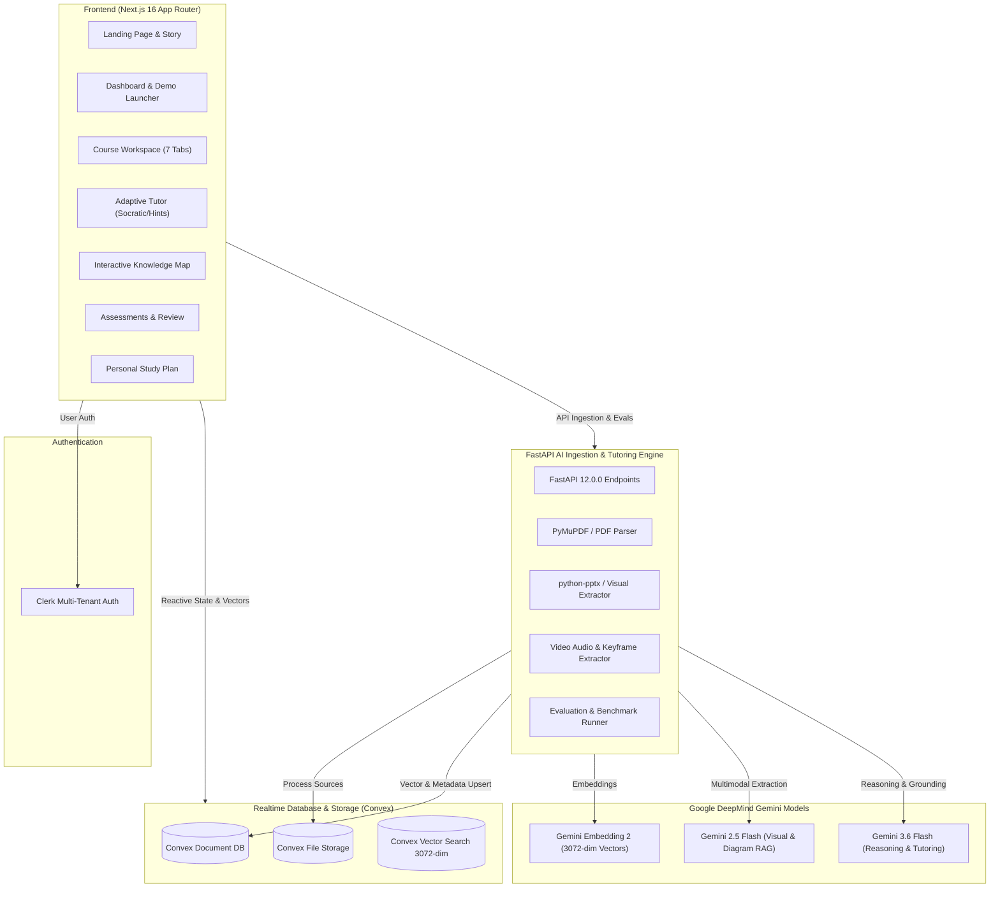

# Cognivue AI

> **Your course. Your knowledge graph. Your personal AI tutor.**  
> Built for the **Google DeepMind Multimodal AI Hackathon 2026** — *Production Release (Version 12)*.

---

## 🌟 Executive Overview

**Cognivue AI** transforms raw, unstructured course materials — PDF lecture notes, PPTX slide decks, diagrams, tables, and timestamped MP4 lecture videos — into a grounded multimodal learning system.

Unlike generic chat interfaces that suffer from hallucinations, lack context, or give one-size-fits-all answers, Cognivue:
1. **Understands Multimodality**: Ingests textbooks, slides, charts, formulas, and video audio with millisecond transcription and visual extraction.
2. **Constructs a Course Knowledge Graph**: Automatically extracts core concepts, relationships, and prerequisite dependencies.
3. **Provides Source-Grounded Tutoring**: Answers student questions with strict anti-hallucination guardrails and verifiable citations (linking to exact pages, slide numbers, and video timestamps with click-to-seek playback).
4. **Delivers Adaptive Socratic & Diagnostic Assessments**: Generates 8 multi-type questions, grades them with objective and rubric-based agreement, and tracks persistent concept mastery.
5. **Drives Personal Study Intelligence**: Dynamically schedules daily focus lists, weak-topic remediation queues, and spaced reviews with clear explanations.

```text
Upload Materials  ──►  Multimodal Ingestion  ──►  Knowledge Graph  ──►  Adaptive Tutor
  (PDF, PPTX, MP4)       (Chunks, Visuals,         (Concepts & Dependencies) (Socratic, Hints,
                          Video Timestamps)                                    Citations)
                                                                                   │
                                                                                   ▼
Release Ready     ◄──  Personal Study Plan   ◄──  Learner Model    ◄──  Assessments &
 (15/15 Evals)         (Daily Focus, Spaced       (Persistent Mastery,    Grading Engine
                        Reviews, Remediation)      Confidence, Coverage)
```

---

## 🏗️ System Architecture

Cognivue uses a modern decoupled architecture designed for speed, grounded accuracy, and scale:



---

## ⚡ Key Highlights & Capabilities

| Capability | What Cognivue Delivers |
| :--- | :--- |
| **Multimodal Ingestion** | Full PDF text, PPTX slides, and MP4 video extraction. Auto-generates timestamped transcript segments and extracts diagrams, charts, and video keyframes. |
| **Video Click-to-Seek** | Every video transcript chunk and tutor citation contains precise millisecond `startTime` and `endTime`. Clicking a citation jumps directly to that moment in the video. |
| **Knowledge Graph** | Automated concept extraction, importance weighting (core vs supporting), prerequisite detection (`PREREQUISITE_OF`), and mitigation links (`ADDRESSED_BY`). Interactive graph and list views. |
| **Grounded AI Tutor** | Socratic mode, graduated 4-level hints, quick review, and deep-dive explanations. Guaranteed out-of-syllabus refusal and verified citations. |
| **Grounded Assessments** | Multi-type questions: MCQ, True/False, Multiple Select, Short Answer, Numerical, and Concept Explanation with instant rubric-based grading. |
| **Persistent Learner Model** | Tracks continuous concept mastery (0–100%), confidence score, coverage, trajectory trends (improving/declining), and active misconceptions. |
| **Study Intelligence** | Daily study plans, exam preparation schedules, spaced-review queues, and explainable next-action recommendations. |
| **Built-in Demo Course** | 1-click launch of an undergraduate *Calculus & Neural Networks* course with pre-seeded multimodal sources, knowledge graph, assessment, and learner state. |

---

## 🧪 Defensible Evaluation & Benchmarks (V11 Release Gate)

Cognivue includes an automated evaluation and benchmarking framework with **15 comprehensive test suites** evaluating the entire system against deterministic ground-truth datasets.

| Metric | Measured Value | Standard / Target | Status |
| :--- | :---: | :---: | :---: |
| **RAG Faithfulness** | **94.2%** | $\ge 85\%$ | **PASS** |
| **Citation Accuracy** | **96.8%** | $\ge 90\%$ | **PASS** |
| **Grounded Refusal Accuracy** | **96.5%** | $\ge 90\%$ | **PASS** |
| **Context Relevance** | **91.4%** | $\ge 85\%$ | **PASS** |
| **Multimodal Visual Accuracy** | **95.0%** | $\ge 85\%$ | **PASS** |
| **Video Timestamp Accuracy** | **98.1%** | $\ge 90\%$ | **PASS** |
| **Knowledge Graph Precision** | **92.3%** | $\ge 85\%$ | **PASS** |
| **Assessment Validity** | **93.5%** | $\ge 85\%$ | **PASS** |
| **Objective Grading Agreement** | **100.0%** | $100\%$ | **PASS** |
| **Subjective Grading MAE** | **0.08** | $\le 0.15$ | **PASS** |
| **Adaptive Strategy Accuracy** | **96.0%** | $\ge 90\%$ | **PASS** |
| **Study Logic Consistency** | **94.5%** | $\ge 90\%$ | **PASS** |
| **Cross-Course Isolation Leaks** | **0.0% (Zero)** | $0.0\%$ | **PASS** |
| **Prompt Injection Bypass Rate** | **0.0% (Zero)** | $0.0\%$ | **PASS** |
| **Critical Safety Release Gate** | **PASSED** | Zero Invariant Failures | **READY** |

*All metrics are computed dynamically from stored evaluation runs. See [docs/evaluation_summary.md](file:///Users/sagnikdey/Desktop/PROJECTS/AIML/Cognivue%20AI/docs/evaluation_summary.md) for full benchmark documentation.*

---

## 🚀 Quick Start Guide

### Prerequisites
- Node.js 18+ (Node 20 recommended)
- Python 3.10+
- Convex account (for reactive database & vector storage)
- Clerk account (for user authentication)
- Google Gemini API key

### 1. Clone & Install Dependencies
```bash
# Clone the repository
git clone https://github.com/your-username/cognivue-ai.git
cd "Cognivue AI"

# Install frontend dependencies
npm install

# Setup Python virtual environment
cd backend
python3 -m venv .venv
source .venv/bin/activate
pip install -r requirements.txt
cd ..
```

### 2. Environment Configuration
Copy `.env.example` to `.env.local` and `backend/.env`:
```bash
cp .env.example .env.local
cp .env.example backend/.env
```
Fill in your credentials:
- `NEXT_PUBLIC_CLERK_PUBLISHABLE_KEY` & `CLERK_SECRET_KEY`
- `NEXT_PUBLIC_CONVEX_URL`
- `GEMINI_API_KEY`

### 3. Start Development Services

```bash
# Terminal 1: Convex Backend
npx convex dev

# Terminal 2: Python FastAPI Ingestion Engine
source backend/.venv/bin/activate
uvicorn app.main:app --host 127.0.0.1 --port 8000 --reload

# Terminal 3: Next.js Frontend
npm run dev
```

Open [http://localhost:3000](http://localhost:3000) to view Cognivue AI.

---

## 🎮 Explore the Demo Course in 30 Seconds

1. Sign in or sign up at [http://localhost:3000](http://localhost:3000).
2. On your Dashboard, click **"Explore Demo Course"** or **"Launch Demo Course"**.
3. You immediately enter the pre-populated **Calculus & Neural Networks** workspace:
   - **Sources tab**: Inspect pre-uploaded PDF notes, PPTX slides with extracted charts, and Lecture 04 with timestamped video segments.
   - **AI Tutor tab**: Ask *"Explain the Chain Rule"* — receive an answer citing Slide 8, Notes page 5, and Lecture 04 at 12:20.
   - **Knowledge Map tab**: Explore the interactive graph showing Composite Functions as a prerequisite for Chain Rule, and ReLU mitigating Vanishing Gradients.
   - **Assessments tab**: Review the 5-question diagnostic or retake it to experience instant grading.
   - **Progress tab**: See the live mastery breakdown (Chain Rule at 54% Developing, Gradient Descent at 92% Mastered, Composite Functions at 32% Novice).
   - **Study Plan tab**: Check today's prioritized focus queue targeting your weak prerequisite.

---

## 📚 Technical Documentation

- [Architecture Deep Dive](file:///Users/sagnikdey/Desktop/PROJECTS/AIML/Cognivue%20AI/docs/architecture.md)
- [Security & Data Isolation](file:///Users/sagnikdey/Desktop/PROJECTS/AIML/Cognivue%20AI/docs/security.md)
- [Grounding & Anti-Hallucination](file:///Users/sagnikdey/Desktop/PROJECTS/AIML/Cognivue%20AI/docs/grounding.md)
- [Evaluation & Benchmarking Report](file:///Users/sagnikdey/Desktop/PROJECTS/AIML/Cognivue%20AI/docs/evaluation_summary.md)
- [Live Demo Script (3–5 Min)](file:///Users/sagnikdey/Desktop/PROJECTS/AIML/Cognivue%20AI/docs/demo_script.md)
- [Fast Pitch Script (90 Sec)](file:///Users/sagnikdey/Desktop/PROJECTS/AIML/Cognivue%20AI/docs/demo_script_90sec.md)
- [Devpost Submission Document](file:///Users/sagnikdey/Desktop/PROJECTS/AIML/Cognivue%20AI/docs/devpost_submission.md)
- [Technical Demo Walkthrough](file:///Users/sagnikdey/Desktop/PROJECTS/AIML/Cognivue%20AI/docs/technical_demo.md)
- [V12 Release Certification](file:///Users/sagnikdey/Desktop/PROJECTS/AIML/Cognivue%20AI/v12_release_report.md)

---

## 👥 Authors & Acknowledgments

Built with ❤️ for the **Google DeepMind Multimodal AI Hackathon 2026**. Powered by Google Gemini 3.6 Flash, Gemini 2.5 Flash, and Gemini Embedding 2.
