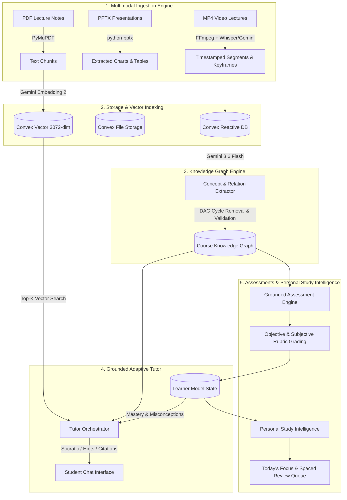

# Cognivue AI — Architecture Deep Dive

## 1. System Overview

Cognivue AI is a full-stack multimodal learning intelligence platform designed to ingest educational content across multiple formats (text, slides, audio, video, diagrams) and synthesize it into a grounded, personalized learning experience.

---

## 2. Ingestion & Multimodal Processing Pipeline

1. **Text Extraction & Normalization**:
   - PyMuPDF parses PDF pages, preserving headings, section paths, and page numbers.
   - Recursive character chunking maintains sliding overlap without splitting semantic formulas.
2. **Slide & Visual Extraction**:
   - `python-pptx` iterates slide shapes to isolate charts, tables, and vector graphics.
   - High-resolution visual crops are generated and cataloged with metadata (`visualType`, `slideNumber`, `description`, `confidence`).
3. **Video Transcription & Click-to-Seek**:
   - Audio tracks are isolated and transcribed with millisecond timestamps (`startTime`, `endTime`).
   - Transcript segments are linked to keyframe screenshots extracted during slide transitions.
   - Every citation rendered in the frontend contains a seekable timestamp: clicking it triggers an HTML5 video playback update to `video.currentTime = startTime`.

---

## 3. Knowledge Graph Engine

- **Concept Extraction**: Gemini 3.6 Flash identifies core and supporting concepts, generating normalized keys, canonical names, and aliases.
- **Relationship Discovery**: Identifies `PREREQUISITE_OF` dependencies and `ADDRESSED_BY` mitigations.
- **Topological Integrity**: Cycle detection ensures the prerequisite graph is a directed acyclic graph (DAG), eliminating circular dependency deadlocks.
- **Traceability**: Every concept and relationship maintains direct references to the source chunk IDs that substantiate its existence.

---

## 4. Grounded Adaptive Tutoring Engine

The Tutor operates under a strict anti-hallucination contract:
- **Grounding Gate**: If vector retrieval yields low relevance ($\text{score} < 0.65$), the tutor explicitly refuses the question rather than guessing.
- **Trusted Citations**: Every factual claim is annotated with citations linking to source document page numbers, slide indices, or video timestamps.
- **Adaptive Modes**:
  - `Adaptive`: Adjusts explanation depth based on student mastery band.
  - `Socratic`: Guides the student through reflective questions with a safety valve ("just tell me").
  - `Hint`: Provides 4-level progressive scaffolding.
  - `Quick Review`: Summarizes core principles and formulas.
  - `Deep Dive`: Explores theoretical mechanisms and cross-concept connections.

---

## 5. Assessment & Grading Engine

- Supports 8 question types: Multiple Choice (MCQ), Multiple Select, True/False, Short Answer, Numerical, Concept Explanation, Visual Diagram, and Video Timeline.
- **Objective Grading**: Exact matching with case and whitespace tolerance.
- **Subjective Grading**: Strict rubric evaluation with evidence citation and prompt-injection defense.
- **Learner Model Updating**: Grades immediately update concept-level observations, computing continuous mastery scores ($0.0$ to $1.0$), Bayesian confidence, and trajectory trends without destructive overwrites.

---

## 6. Personal Study Intelligence

- **Priority Calculation**:
  $$\text{Priority} = w_1 \cdot (1 - \text{Mastery}) + w_2 \cdot \text{BlockerScore} + w_3 \cdot \text{MisconceptionSeverity} + w_4 \cdot \text{SpacedDue}$$
- **Remediation Queuing**: Concepts identified as weak prerequisites blocking downstream topics are elevated to Critical Priority.
- **Spaced Review**: Implements exponential interval review scheduling (1, 3, 7, 14, 30 days) based on recall outcomes.
- **Closed-Loop Reprioritization**: As students complete assessments and study activities, the study plan rebalances dynamically.
